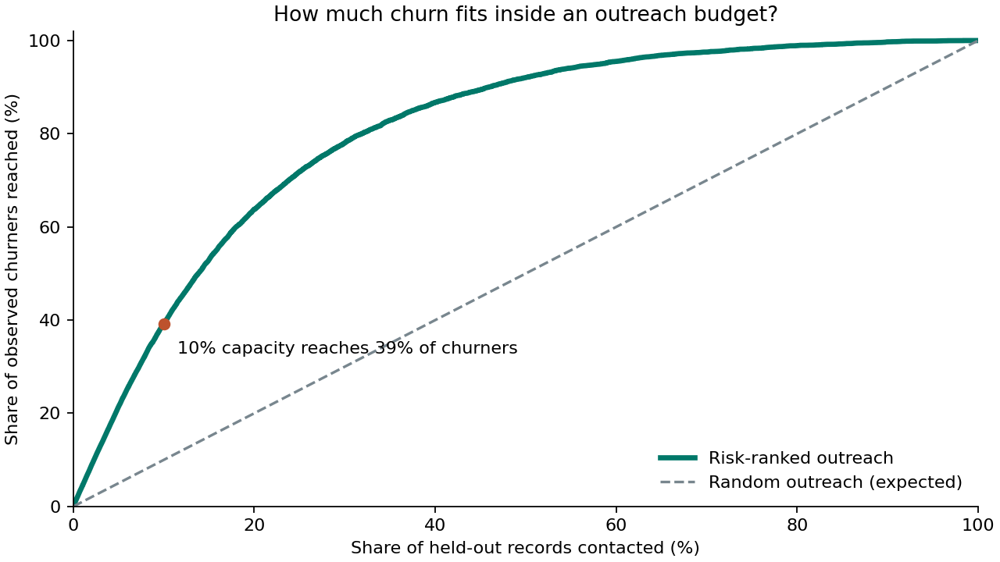

# Customer bank churn prediction

**If a bank can contact only one in ten accounts, how many potential exits can it reach?** On a held-out sample of 33,363 synthetic bank records, ranking by Logistic Regression risk put **2,800 of 7,142 observed exits** in the first 3,336 contacts. That gives **83.9% precision**, **39.2% capture**, and **3.92× lift** over random selection at the same capacity.



## What changed the prediction

The training data show a sharp reversal across product counts. Churn was **34.6%** for one product, **6.0%** for two, and **88.1%** for three. A plain Logistic Regression assigns a single slope to product count. A categorical representation lets the model learn the dip at two products. The three-product group contained just 1,708 training records, so its unusually high rate deserves scrutiny before using it for a real campaign. [Training segment counts and rates](reports/training_segments.csv)

The comparison keeps the training rows, split, estimator family and threshold-selection rule fixed. The engineered model replaces numeric product count with product-by-funding and product-by-geography categories, adds changes in age slope at 35, 45, 55 and 65, and allows the age slope to vary with active membership. The measured gain applies to these changes together.

| Held-out metric | Plain Logistic Regression | Feature-engineered Logistic Regression |
| --- | ---: | ---: |
| Positive-class F1 | 0.582 | **0.663** |
| Precision | 0.521 | 0.630 |
| Recall | 0.660 | 0.699 |
| Average precision | 0.595 | 0.727 |
| ROC AUC | 0.819 | 0.888 |
| Threshold chosen on validation | 0.275 | 0.324 |

At the engineered model's threshold, 4,993 exits were flagged, 2,149 were missed, and 2,932 records were false positives. F1 measures the balance of precision and recall for `Exited = 1`. The budget analysis below uses the same scores and takes the highest-ranked records that fit the available capacity. [Full metrics and confusion counts](reports/test_metrics.csv)

## Choosing an outreach budget

| Capacity | Contacts | Observed exits reached | Precision | Share of all exits reached |
| ---: | ---: | ---: | ---: | ---: |
| 5% | 1,668 | 1,528 | 91.6% | 21.4% |
| 10% | 3,336 | 2,800 | 83.9% | 39.2% |
| 20% | 6,672 | 4,552 | 68.2% | 63.7% |

Doubling capacity from 10% to 20% adds 3,336 contacts and reaches 1,752 additional observed exits. The **marginal precision is 52.5%**. A retention manager can use that figure to decide whether the next batch merits a pilot. Estimating prevented exits or financial return would require an intervention, a randomized holdout, contact costs and customer value. Each contact in this simulation represents one scored record. [All budget scenarios](reports/capacity.csv)

## Data and evaluation design

Walter Reade and Ashley Chow's 2024 Kaggle Playground Series provides 165,034 labeled synthetic records. The outcome is whether the customer exited. The analysis uses the labeled competition training file for internal development and evaluation. The source data page lists CC BY 4.0. The download script fetches a commit-pinned mirror and verifies the SHA-256 checksum. [Original dataset and attribution](https://www.kaggle.com/competitions/playground-series-s4e1/data) · [Download mirror](https://github.com/aaronteork/kaggle-binary_classification_bank_churn/tree/911becd02278325cfaeaaeb8bb55e79bb9635a66/data)

1. **Group before fitting.** The 165,034 rows contain 23,221 distinct customer IDs. Two seeded group splits keep every occurrence of each ID in one partition. Train, validation and test have 99,241, 32,430 and 33,363 rows respectively. An assertion checks for overlapping IDs. Row ID, customer ID and surname are excluded from the predictors. [Split audit](reports/splits.csv)
2. **Profile and clean training data.** Profile churn by product count, geography and active status. Zero balances are common and retained. Among positive training balances, exclude observations beyond three interquartile ranges below Q1 or above Q3. This removes five training records. Both evaluation partitions retain their full balance ranges. The pinned input has no missing values. [Outlier cutoffs](reports/outliers.csv)
3. **Encode and scale.** Fit one-hot encoding for categories and standard scaling for numeric fields on the remaining 99,236 training rows. The scikit-learn pipeline reuses those transformations at validation and test time and accepts previously unseen categories.
4. **Select the operating point.** For each model independently, choose the threshold maximizing churn-class F1 on validation. Apply that threshold to test scores. For capacity analysis, sort by decreasing score and use row ID to break ties.
5. **Inspect who gets flagged.** At the engineered model's selected threshold, recall was 77.4% for records labeled female and 59.5% for those labeled male. By geography it ranged from 62.1% in Spain to 80.9% in Germany. These gaps warrant review alongside group prevalence, flag rates and precision. [Cohort audit](reports/cohort_audit.csv)

## Reproduce the analysis

Use Python 3.12. Run from the repository root. The first download needs internet access. Subsequent runs use the verified local copy.

```powershell
python -m venv .venv
.\.venv\Scripts\python -m pip install -r requirements.txt
.\.venv\Scripts\python download.py
.\.venv\Scripts\python analysis.py
```

On macOS or Linux, use `.venv/bin/python` for the last three commands. The analysis prints the model comparison and regenerates all tables and the chart in `reports/`. You can also place the pinned training CSV at `data/train.csv` and run the same commands. A checksum mismatch stops the run.

| File | Purpose |
| --- | --- |
| [download.py](download.py) | Retrieve and verify the dataset |
| [analysis.py](analysis.py) | Split, profile, train, select thresholds and evaluate outreach |
| [requirements.txt](requirements.txt) | Direct dependency versions used for the reported run |
| [reports/](reports/) | Reviewable outputs from the completed experiment |

## Interpretation and limits

The grouped holdout measures generalization to unseen IDs within one synthetic dataset. It has no event timestamps, intervention history or prediction horizon. A bank pilot would need a dated feature snapshot and a precise outcome window, such as closure within the following 90 days. Repeated synthetic IDs also limit the interpretation of record-level rankings as a unique customer call list. The model includes age, geography and gender, and the cohort audit describes performance differences that a deployment review would need to address.

**Placement summary:** Analyzed 165,034 synthetic bank records and improved held-out churn-class F1 from 0.582 to 0.663 with feature-engineered Logistic Regression. At 10% outreach capacity, the model captured 39.2% of observed exits, delivering 3.92× lift over random selection.
